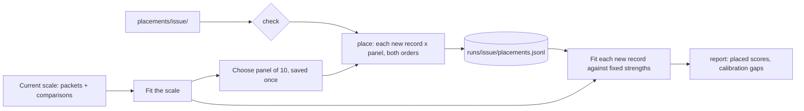

# Phase 6: placing new records on a frozen scale

**Status:** Approved
**Owner:** Jared Borgese
**Last updated:** 2026-11-26
**Related:** research doc ([US Political Alignment in International Context](https://claude.ai/artifact/FweXcgFWFgWdpf6JHGvvc1)), sections "Cheaper comparisons and the left-right axis" and "Chamber diagrams for phase 6"; PRs #18 and #19

---

## 1. Overview / business context

### 1.1 Problem statement

1. The project needs a score for about 525 more people (the rest of the House and all 100 senators) in each issue. Today every record is compared with every other record in both orders, so the cost grows with the square of the number of records: about 300,000 comparisons per issue at 550 records, against 650 now.
2. Records written by hand, like the 23 in each issue today, cannot be produced for 525 people per issue. Records built from votes and bill sponsorships can, but nobody yet knows whether a thinner record of that kind scores the same as a researched record of the same person.
3. Each issue's published scale is the result of a paid run that has passed its gates. Adding people must not move the scores already published.
4. Members-elect have no record in the House until they take office, yet readers look for them from election day. Many have a record from a prior office; some have only campaign positions.

**Spec category:** Feature. It adds a new way to score records onto the existing tool, alongside the current full rating, without changing how today's scales are built.

### 1.2 Business / customer outcome

Readers of uspolitics.frootsnoops.com can find any member of Congress on each issue and on the left-right axis. Success is measured by:

- **Cost:** tens of dollars per issue for all of Congress, not thousands.
- **Accuracy:** a new person's score lands within the 10 points the wording test already accepts of the score a full rating would give.
- **Stability of what is published:** no published score moves when new people are added.

### 1.3 Dependencies & assumptions

- **Depends on:** API credit for the paid runs; official roll-call and sponsorship data for the record-building pipeline (a separate spec); Jared's approval of each paid run.
- **Assumes:** the rater stays `claude-opus-5-5`, and the current scales stay as they are while people are placed against them.
- **Risks if wrong:** if records built from votes and bills score differently from researched records, the chamber diagrams would compare unlike things.

### 1.4 Tenets / constraints

- **Blinding holds:** a placed record goes through the same checks and the same message builder as any other record; the rater never sees a name, party, id or source.
- **Published scores do not move:** placing people reads the existing scale; it never refits it.
- **One rater per issue:** placements use the model that rated the issue.
- **Every paid step asks first,** as the rate and stability runs do today.

---

## 2. Goals

**Goal 1 — Place a new record cheaply**
As the project owner, I want to score a new person on an issue for a small, fixed cost so that covering all of Congress costs tens of dollars per issue, not thousands.
**Success signal:** a new person's score appears in the issue's report after one paid batch.

**Goal 2 — Know whether vote-built records can be trusted**
As the project owner, I want to compare vote-built versions of the 10 pilot members with their researched records so that I decide on the record-building pipeline with evidence.
**Success signal:** the report lists each pilot member's researched score, vote-built score and the gap, and states whether the calibration line holds.

**Goal 3 — Show members-elect before they have voted**
As a reader, I want to see where an incoming member stands, marked as provisional, so that new members are not missing for their first months.
**Success signal:** each of the first six members-elect has a provisional placed score in each live issue's report.

**Goal 4 — Leave published work alone**
As a reader, I want the scores I have already seen to stay put when new people are added so that the site stays trustworthy.
**Success signal:** every existing report regenerates unchanged after placements are added.

---

## 3. Out of scope

- **Building records from roll calls and sponsorships:** a separate spec, once calibration shows it is worth doing.
- **Senate events:** each issue's Senate list is evidence work for that pipeline.
- **Chamber diagrams, moving House members off the main chart, and the provisional mark for members-elect:** the site work comes after people are placed (see the research doc's "Chamber diagrams" section).
- **Wording stability for placed records:** deferred until there are placed records to sample; the size of the sample is an open decision.
- **Changing how the current 26-record scales are rated:** they keep the full design.

---

## 4. Proposed solution

### 4.1 Summary

A new `place` command compares each new record with a fixed panel of 10 records from the issue's current scale, in both orders. Its score comes from fitting it against those records' current strengths, which stay fixed, so nothing already published moves. New records live in their own folder and their own run files, separate from the issue's scale. Copies of existing subjects (vote-built versions of the pilot members) use the same path and are reported beside the original as the calibration test. This beats refitting one large scale because the cost per person is constant and published scores cannot drift.

### 4.2 Diagram



### 4.3 Component designs

#### 4.3.1 Placement records

**Responsibility:** hold the evidence for people placed onto an issue's scale, kept apart from the records that define the scale.

**Interfaces:** read by `loadRatingSet` from `placements/<issue>/`; same schema as `packets/`.

**Access and data:** none beyond the existing blinding rules.

- `placements/<issue>/<subjectId>.json` places a subject listed in `key.json` that has no packet in `packets/<issue>/`.
- `placements/<issue>/<subjectId>.<label>.json` (for example `s01.votes.json`) is a calibration copy of a subject that is on the scale. It takes that subject's legislature and events, is reported beside the subject's own score, and is never published.

**Callouts:**
- `findSetProblems` must cover placement records too (revealing terms, slots, stances on every event), or a placed record could leak a name.
- A subject with a file in both `packets/` and `placements/` is a problem `check` refuses; it is either on the scale or placed, never both.

**Open questions:**
- None.

#### 4.3.2 Panel

**Responsibility:** choose the 10 scale records every new record is compared with, and keep that choice fixed so placements stay comparable.

**Interfaces:** chosen on the first `place` run from the fitted scale; saved to `runs/<issue>/panel.json`; read by later runs and by the report.

**Access and data:** none.

```json
{ "chosenAt": "2026-11-26T00:00:00.000Z", "ids": ["anchor-protective", "s05", "…"] }
```

**Callouts:**
- Rank the scale's records by fitted strength, leave out records held back from the site, and take 10 evenly spaced by rank, so the panel runs from the high anchor to the low one. Records tied on the scale (the same wins and losses) are ordered by id, so the same scale always gives the same panel. This is the design simulated in the research doc.
- The panel is not re-chosen when the scale is re-rated, so earlier placement answers stay usable. A panel member whose record changes gets its pairs re-rated through the existing fingerprint check.

**Decided (26 November 2026):**
- A panel member that is later held back stays on the panel; the panel is re-chosen only on request.

#### 4.3.3 `place` command

**Responsibility:** submit and collect the paid comparisons between new records and the panel.

**Interfaces:** `npm run place -- <issue> [limit]`; writes `runs/<issue>/placements.jsonl`, `placements-superseded.jsonl` and `placements-batch.json`; reuses `rateRun` with a plan of each placement record against each panel member in both orders.

**Access and data:** needs `.env` and costs money; refuses to start until the issue itself is fully rated, with the same model and its anchors in order, and when `placements/<issue>/` holds no record with evidence; asks first, as `rate` and `stability` do.

**Callouts:**
- `check` reports the placement comparisons still to rate and their tokens, as it does for stability.
- Placement records are never compared with each other, so adding one costs 20 comparisons whatever the count.

**Open questions:**
- None.

#### 4.3.4 Fitting against a fixed scale

**Responsibility:** turn a placed record's answers into a score on the issue's 0 to 100 scale without refitting the scale.

**Interfaces:** a pure function in `src/scoring.ts` taking the scale's fitted strengths and the record's outcomes, returning its strength; anchored with the scale's anchors, as today.

**Access and data:** none.

**Callouts:**
- Same model and prior as `fitBradleyTerry`: the record's wins and losses against each panel member, plus 0.1 of a win each way per pair, solved for the record's strength alone.
- A record that beats or loses to every panel member lands beyond 0 or 100, bounded by the prior; scores outside 0 to 100 already exist today.

**Open questions:**
- None.

#### 4.3.5 Report

**Responsibility:** show placed scores and the calibration result next to the scale.

**Interfaces:** `npm run report -- <issue>`; new sections in `runs/<issue>/report.md`.

**Access and data:** none.

**Callouts:**
- "Placed on the scale": each placed subject's score, with the held-back rules applied as for scale records (fewer than 3 official acts, more than 15% of its pairs changing winner with the order).
- "Calibration": for each copy, the subject's own score, the copy's score and the gap, then whether the calibration line holds.

**Decided (26 November 2026):**
- The calibration line holds when the mean gap is 5 points or less and no copy is more than 10 points from its subject, the same 10-point line as the wording test.

#### 4.3.6 Members-elect

**Responsibility:** place a member-elect from acts in a prior office and stated intentions, and mark the score provisional until their first session ends.

**Interfaces:** `"provisional": true` on the subject in `key.json`; their packets in `placements/<issue>/`; `thinEvidenceReasons` and `findSetProblems` in `src/ratingSet.ts`; the evidence rules in `README.md`, "Members-elect".

**Access and data:** none beyond the existing blinding rules.

**Callouts:**
- Prior-office acts are official acts worded with their level ("As a regional legislator, …"); campaign positions are statements of an intended act; stances on the House events are statement-tier or listed under `noPosition`.
- A provisional record needs at least 3 items that are official acts or statements, instead of 3 official acts. The other hold-back rules are unchanged.
- `check` refuses a provisional subject in `packets/`, so the scale is built only from records of people in office.
- **Risk:** the rater weighs official acts above statements, so a record of stated intentions may land nearer the middle than its positions warrant. Ticket 4's statement-only copies measure that before any campaign-only record is shown.

**Decided (26 November 2026):**
- Evidence: prior-office acts plus campaign positions, not an estimate from a group the member belongs to.
- Display: shown with a provisional mark; the site work is separate (see [§3](#3-out-of-scope)).
- First six: Claire Valdez, Darializa Avila Chevalier, Janelle Stelson, Houston Gaines, Steve Toth and Ed Gallrein, three from each party, with and without a prior office.

**Open questions:**
- When the first session ends: how the record is rebuilt from House votes, and whether campaign positions stay as statements.
- Placed records have no wording test, so a provisional member has no range bar.

---

## 5. Implementation plan

### Ticket 1 — Fit a record against a fixed scale, and choose a panel

**User Story:**
As the project owner, I need the pure logic for placement so that the paid command has a tested core.

**Acceptance Criteria (checkbox-ready):**
- **Fitting**
  - [ ] A record that beats every panel member below a given one and loses to every one above it scores between those two.
  - [ ] Placing a record already on the scale, with its own answers against the panel, lands within a few points of its full-design score.
  - [ ] A record that wins every pair scores above the top panel member and stays finite.
- **Panel**
  - [ ] Ten records evenly spaced by rank, from the high anchor to the low one, leaving out held-back records.
  - [ ] The same scale always gives the same panel.

**Callouts:**
- **Backend logic** (`src/scoring.ts`, `src/placement.ts`): the fixed-strength fit and panel choice.

**Rollout:**
**Test plan:** unit tests in `test/scoring.test.ts` and `test/placement.test.ts`; a replay on the four live issues' saved answers matching the simulation.
**Legacy / migration handling:** none; nothing reads it yet.

**Definition of done:** tests and typecheck pass; replay errors match the research doc.
**Rollback / feature flag:** revert the PR.

### Ticket 2 — Placement records and the `place` command

**User Story:**
As the project owner, I need to put new records in a folder and run one paid command so that they are compared with the panel.

**Acceptance Criteria (checkbox-ready):**
- **Records**
  - [ ] `placements/<issue>/` loads with the packet schema; calibration copies take their subject's legislature.
  - [ ] `check` refuses a placed record with a revealing term, a missing stance, or a subject that is also on the scale.
  - [ ] `check` prints the placement comparisons still to rate and their tokens.
- **Command**
  - [ ] `place` refuses before the issue is fully rated, or with another model.
  - [ ] The first run saves the panel; each record gets 20 comparisons, both orders against each panel member.
  - [ ] Answers go to `placements.jsonl`; the issue's own runs are untouched.

**Callouts:**
- **Shared types** (`src/files.ts`): placement records and run paths in `RatingSet` and `pathsFor`.
- **Backend logic** (`src/rate.ts`, `src/ratingSet.ts`, `src/cli.ts`): the command, checks and plan.

**Rollout:**
**Test plan:** `test/rate.test.ts` with the mocked rater, as for stability; `test/ratingSet.test.ts` for the new checks.
**Legacy / migration handling:** issues without a `placements/` folder behave exactly as today.

**Definition of done:** tests pass; every live issue's `check` and report are unchanged.
**Rollback / feature flag:** revert the PR; no data written until a paid run.

### Ticket 3 — Report placed scores and calibration

**User Story:**
As the project owner, I need the report to show placed scores and the calibration gaps so that I can judge the vote-built records.

**Acceptance Criteria (checkbox-ready):**
- [ ] Placed subjects are listed with their scores and any held-back reason.
- [ ] Each calibration copy shows its subject's score, its own score, the gap, and whether the calibration line holds.
- [ ] A report with no placements is unchanged.

**Callouts:**
- **Backend logic** (`src/report.ts`): two new sections.

**Rollout:**
**Test plan:** `test/report.test.ts`; regenerate the four live reports and confirm they are unchanged.
**Legacy / migration handling:** none.

**Definition of done:** tests pass; live reports unchanged.
**Rollback / feature flag:** revert the PR.

### Ticket 4 — Calibration run

**User Story:**
As the project owner, I need vote-built versions of the 10 pilot members on the four live issues so that I can decide on the record-building pipeline.

**Acceptance Criteria (checkbox-ready):**
- [ ] One copy per pilot member per issue (`<id>.votes.json`): stances on every event plus cosponsored or sponsored bills from an agreed list per issue; no influence or statement items.
- [ ] `check` passes on all four issues.
- [ ] Statement-only copies (`<id>.statements.json`) of 4 pilot members spread across each issue's scale: statements of intended acts only, at least 3 items each.
- [ ] After Jared approves, one `place` run per issue (about 280 comparisons, 80 of them for the statement-only copies); the report states whether the calibration line holds for each kind of copy.

**Callouts:**
- **External / prerequisites:** the bill list per issue needs Jared's agreement before the copies are written.

**Rollout:**
**Test plan:** the run itself, read against the calibration line.
**Legacy / migration handling:** copies are never published.

**Definition of done:** calibration result recorded in the research doc.
**Rollback / feature flag:** delete the copies and their run files.

### Ticket 5 — Member-elect rules

**User Story:**
As the project owner, I need the tool to accept members-elect so that they can be placed from the evidence they have.

**Acceptance Criteria (checkbox-ready):**
- [ ] `key.json` accepts `"provisional": true` on a subject.
- [ ] A provisional record is held back only when it has fewer than 3 items that are official acts or statements.
- [ ] `check` refuses a provisional subject in `packets/`.
- [ ] `README.md` gives the evidence rules for members-elect.

**Callouts:**
- **Shared types** (`src/files.ts`): the key schema.
- **Backend logic** (`src/ratingSet.ts`): the hold-back count and the new check.

**Rollout:**
**Test plan:** `test/ratingSet.test.ts`; regenerate the four live reports and confirm they are unchanged.
**Legacy / migration handling:** no subject is provisional yet.

**Definition of done:** tests pass; live reports unchanged.
**Rollback / feature flag:** revert the PR.

### Ticket 6 — The first six members-elect

**User Story:**
As the project owner, I need records for six members-elect on the four live issues so that the method is tested on both kinds of member before the rest of the freshman class.

**Acceptance Criteria (checkbox-ready):**
- [ ] Key entries with `"provisional": true` and packets in `placements/<issue>/`, reviewed by Jared before any paid run.
- [ ] Each prior office confirmed against the legislature's own records.
- [ ] After Jared approves, one `place` run per issue: 120 comparisons each, 480 in all.
- [ ] Campaign-only records go on the site only if Ticket 4's statement-only copies hold the calibration line.

**Callouts:**
- **External / prerequisites:** Tickets 3 to 5 merged.

**Rollout:**
**Test plan:** `check` on all four issues; the run itself, read in the report.
**Legacy / migration handling:** none.

**Definition of done:** six provisional scores in each live issue's report.
**Rollback / feature flag:** delete the packets, key entries and run files.

---

## 6. Rollout plan

### 6.1 Release strategy

Tickets 1 to 3 and 5 merge with no paid run and no change to the site or to any published score. Tickets 4 and 6 are the paid steps and run one issue at a time with Jared's approval.

### 6.2 Operational readiness

Regenerating the four live reports after each merge must give identical files; that is the check that published work did not move.

### 6.3 Rollback triggers

- Any live report changes after a merge: revert that PR.
- The calibration line fails: stop before the record-building pipeline, and revisit what goes into the records.
- The statement-only copies fail the calibration line: keep campaign-only members-elect off the site, and revisit how stated intentions are weighed.

---

## 7. Appendix

### A. Alternatives considered

| Option | Pros | Cons | Why not chosen |
|--------|------|------|----------------|
| Rate every pair, as today | Exact | About 300,000 comparisons per issue | Cost |
| 12 random opponents per record, refitting everything | Simple | A record more than 10 points off in 62% of simulated runs; moves published scores | Accuracy, stability |
| Binary search against the scale | About 5 comparisons per record | One early wrong answer put a record 33 points off | Accuracy |
| 14-record panel, one order | 14 comparisons per record | Worst error 10.4 points | Accuracy |

### B. Reference tables / mappings

Simulated errors (from the research doc), placing each of the 92 records in the four live issues against the other records:

| Design | Comparisons per record | Mean error | Worst |
|---|---|---|---|
| All other records, both orders | 50 | 1.2 | 3.3 |
| 10-record panel, both orders | 20 | 2.7 | 7.8 |
| 14-record panel, one order | 14 | 2.5 | 10.4 |
| Binary search, one order | about 5 | 3.2 | 29.2 |

### C. Operational runbook notes

`place` runs from a terminal with `.env`, like `rate`; the sandbox shell's proxy blocks the API.

### D. References

- Research doc, "Cheaper comparisons and the left-right axis (26 November 2026)" and "Chamber diagrams for phase 6 (decided 26 November 2026)".
- `README.md`, "Testing the wording", for the 10-point line.
