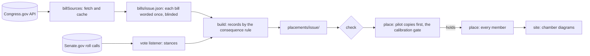

# Record pipeline: members' records from roll calls and bills

**Status:** Draft
**Owner:** Jared Borgese
**Last updated:** 2026-11-26
**Related:** [Phase 6 placement spec](2026-11-phase-6-placement.md) (Ticket 4 calibration, Ticket 7 count-matched panel); [vote listener spec](2026-11-vote-listener.md); research doc ([US Political Alignment in International Context](https://claude.ai/artifact/FweXcgFWFgWdpf6JHGvvc1)), sections "Chamber diagrams for phase 6" and "Count-matched placement: results"; PR #31

---

## 1. Overview / business context

### 1.1 Problem statement

1. The chamber diagrams need a record for every member of both chambers on each published issue: about 425 more House members and 100 senators, roughly 2,100 records across the four live issues. Each of today's researched records took hours, so this cannot be done by hand.
2. Records built from House votes and a short list of flagship bills failed calibration on welfare and health. Their mean gap from the same members' researched records was 9.8 points and the largest 26 (Roy +26, Aguilar +16, Schneider +13, Harris +13). Exact copies placed the same way held at 3.2, so the gap comes from what the records leave out, not from the placement method.
3. No issue has Senate events yet, so a senator's record has no shared votes to take a stance on.
4. Bill titles and official summaries name programs, agencies and places. The rater must never see them, so bill text cannot go into a record as written.

**Spec category:** Feature. It adds a way to build records from official data. It feeds the existing placement and chamber work without changing how scales are rated.

### 1.2 Business / customer outcome

Readers can find every member of Congress on each issue's chamber diagram, placed from evidence the project can show and source. Success is measured by:

- **Coverage:** every current member has a record on each published issue, or a stated reason for none.
- **Agreement with research:** records built this way for the researched pilot members land within the calibration line of the researched records: a mean gap of 5 points or less and none over 10.
- **Cost:** placing a full issue costs about $50 or less.

### 1.3 Dependencies & assumptions

- **Depends on:** the Congress.gov API, which allows 5,000 requests an hour and returns up to 250 results a page; Senate.gov roll-call files; `CONGRESS_API_KEY`; Jared's approval of each paid run.
- **Budget:** the next Max billing cycle's $100 of API credit covers the stability re-run (about $27) and about half of phase 6's placement runs. The rest waits for the following cycle.
- **Assumes:** the rater stays `claude-opus-5-5`, and the four live scales stay as they are while members are placed against them.
- **Risks if wrong:** if built records keep missing the calibration line, most seats stay slashed, and the chambers stay unpublished.

### 1.4 Tenets / constraints

- **Blinding holds.** A built record goes through the same checks and message builder as any other. No name, program, agency or place reaches the rater.
- **Same evidence rules.** Tiers, the 12-item limit, items chosen for consequence rather than volume, and the window from 3 January 2025 apply as they do to researched records.
- **Reproducible.** The same official data and the same rules give the same record, so a record can be rebuilt and audited.
- **Published work does not move.** Building and placing records reads the existing scales and never refits them.
- **Every paid step asks first,** as `rate`, `stability` and `place` do.

---

## 2. Goals

**Goal 1 — A record for every member**
As the project owner, I want each current member's record built from official data so that the chambers can be filled without hand research.
**Success signal:** `check` passes on each live issue with a built record, or a stated reason for none, for every current member.

**Goal 2 — Built records score like researched ones**
As the project owner, I want built versions of the pilot members to land where their researched records do so that a built record can be trusted on the site.
**Success signal:** the built copies of the pilot members hold the calibration line on each issue, with 93% order agreement.

**Goal 3 — The Senate is covered**
As a reader, I want senators placed the same way as House members so that the Senate diagram means the same thing as the House one.
**Success signal:** each live issue has Senate events with roll calls, and the vote listener fills every senator's stances.

**Goal 4 — Cost stays bounded**
As the project owner, I want placing a full issue to cost about $50 so that the work fits two billing cycles.
**Success signal:** each full placement run is within 10% of its estimate from `check`.

---

## 3. Out of scope

- **Statements and influence from press releases or social media.** They are what researched records add beyond votes and bills, but gathering and blinding them at scale is its own project.
- **The chamber diagrams themselves:** built separately (branch `chore/chamber-diagrams`), and published by `site/chambers.json`.
- **Non-voting delegates and the resident commissioner:** they have no floor votes on most events.
- **Wording tests for built records:** deferred, as for every placed record.
- **Social and cultural issues and democratic norms:** not until those issues are rated and published.

---

## 4. Proposed solution

### 4.1 Summary

A new `build` command assembles each member's record for one issue from three sources:

1. their stances on the issue's events in their chamber, which the vote listener already fills;
2. the bills they sponsored in the issue's policy areas;
3. the bills they cosponsored in those areas.

Each bill is worded once, blinded, in a shared bill file, the way events are. A fixed consequence rule picks at most 12 items. Records go to `placements/<issue>/` and are placed against the count-matched panel. A calibration gate on the pilot members decides, issue by issue, whether built records can be shown.

This beats votes alone because the vote-built copies show that a few shared votes cannot tell members of one party apart, while the bills each member chooses to sponsor and cosponsor can.

### 4.2 Diagram



### 4.3 Component designs

#### 4.3.1 Senate events

**Responsibility:** give each live issue a list of Senate votes, so every senator takes a stance on the same changes.

**Interfaces:** a `us-senate` legislature in `events/<issue>.json`. Each event names its vote in `rollCall`, and the vote listener fills senators' stances, as it already does for the House.

**Access and data:** none.

**Callouts:**
- Events are chosen by the size of the change in the official cost estimate, before looking at how anyone voted, as for the House.
- Where the Senate voted on the same law as the House (a budget law, say), the Senate event uses the House event's wording, so both chambers' records describe it alike.
- Votes on nominations and procedural motions are left out; only votes where yes means the text, such as passage, conference reports or concurring, count.

**Open questions:**
- How many Senate events each issue needs before a senator's record clears 3 official acts.

#### 4.3.2 Bill sources

**Responsibility:** fetch each member's sponsored and cosponsored bills, and the summary and cost estimate of each bill chosen.

**Interfaces:** `src/billSources.ts`, the only file that fetches bills, alongside `src/voteSources.ts`. It reads `/member/{id}/sponsored-legislation`, `/member/{id}/cosponsored-legislation` and `/bill/{congress}/{type}/{number}` (with its `summaries` and `cboCostEstimates`). Responses are cached on disk.

**Access and data:** `CONGRESS_API_KEY` from the environment, never logged.

**Callouts:**
- Each listed bill carries its policy area, so filtering by the issue's areas in `votes.json` needs no extra call.
- About 535 members × 2 lists × a few pages comes to roughly 3,000 requests, under one hour of the 5,000-request limit. Bill details are fetched only for bills a record may use.
- Every request has the listener's 60-second timeout and a progress line.

**Open questions:**
- Whether the raw cache is committed, for reproducibility, or only the bill file built from it.

#### 4.3.3 Bill file

**Responsibility:** word each bill once, blinded, so every record that uses it reads the same.

**Interfaces:** `bills/<issue>.json`, keyed by congress, type and number, with the slot, the blinded text, the size where an official estimate gives one, and sources (Congress.gov and the cost estimate). `check` applies the revealing-term check to it, as to events.

**Access and data:** none.

```json
{
  "119-hr-1234": {
    "slot": "changes-health",
    "text": "a bill to extend public health coverage to every resident under 26, at about $40 billion over ten years",
    "sources": ["https://www.congress.gov/bill/119th-congress/house-bill/1234"],
    "status": "introduced"
  }
}
```

**Callouts:**
- A record item reads "Sponsored " or "Cosponsored " plus the bill's text. Sponsoring and cosponsoring are both official acts, as in the researched records.
- Official summaries name programs and places, so the text is redrafted under the README's evidence rules.
- **Wording (decided):** a language model drafts each bill's text from its official summary, and Jared reviews a random sample of each issue's bills before any paid run. Writing every text by hand was rejected for time.
- Built records share the model's drafting style and researched records don't. The calibration gate compares the two kinds of record for the same members, so a pull from the style shows up there.

**Open questions:**
- None.

#### 4.3.4 Record builder

**Responsibility:** turn a member's stances and bills into a record by a fixed rule.

**Interfaces:** `npm run build -- <issue> [preview|write]`. It writes `placements/<issue>/<id>.json` for members without a researched packet, and `<id>.built.json` calibration copies for the pilot members.

**Access and data:** none beyond the fetched public data.

**Callouts:**
- **Consequence rule, in order:** every event stance; then the member's own bills that passed a chamber or were reported by a committee; then cosponsored bills that did; then the rest, by the size in the cost estimate, then by the number of cosponsors. It stops at 12 items.
- A member with no bill and no stance on an issue gets `{ "items": [] }`, which the report lists as having no evidence.
- The builder never overwrites a researched packet. A member with one keeps it.
- New roll calls change stances, so the listener's daily PR lists the built records to re-place.
- **Bill choice (decided):** the most consequential bills come first, as the rule above sets out. Bills that split the member's party get no preference: they would tell members apart better, but choosing them would pick evidence for being different rather than for mattering.

**Open questions:**
- None.

#### 4.3.5 Calibration gate

**Responsibility:** decide, per issue, whether built records can go on the site.

**Interfaces:** the `<id>.built.json` copies of the pilot members, placed with `place`; the report's existing calibration section.

**Access and data:** none.

**Callouts:**
- The gate is the existing calibration line, a mean gap of 5 points or less and none over 10, plus 93% order agreement.
- It costs about 200 comparisons, roughly $1 per issue.
- Only 10 pilot members exist per issue, so the gate is coarse. A pass says the method is sound for members like them, not for every member.

**Open questions:**
- None.

#### 4.3.6 Full placement

**Responsibility:** place every built record on its issue's scale.

**Interfaces:** `npm run place -- <issue>`, with the count-matched panel from PR #31.

**Access and data:** paid; asks first.

**Callouts:**
- About 525 records × 20 comparisons = 10,500 comparisons per issue. At the rate of the last placement run ($3.25 for 660) that is about $52.
- `site/chambers.json` turns a chamber on only once its members are placed on every published issue.

**Open questions:**
- None.

---

## 5. Implementation plan

### Ticket 1 — Senate events for the four live issues

**User Story:**
As the project owner, I need Senate events on each live issue so that senators can be placed.

**Acceptance Criteria (checkbox-ready):**
- [ ] A `us-senate` legislature in each live issue's events file, with roll calls, chosen by the size rule.
- [ ] `npm run votes -- preview` fills stances for the ten senators in a test key.

**Callouts:**
- **External / prerequisites:** Jared approves each issue's list before the PR.

**Rollout:**
**Test plan:** `check` on each issue; the listener's preview.
**Legacy / migration handling:** none; no senator has a record yet.

**Definition of done:** four event lists merged.
**Rollback / feature flag:** remove the legislature.

### Ticket 2 — Bill sources and cache

**User Story:**
As the project owner, I need each member's bills fetched once and cached so that records can be rebuilt without refetching.

**Acceptance Criteria (checkbox-ready):**
- [ ] `src/billSources.ts` lists a member's sponsored and cosponsored bills in one Congress, filtered by policy area.
- [ ] Bill details include the summary and any cost estimate.
- [ ] Requests time out after 60 seconds and print progress.

**Callouts:**
- **Backend logic** (`src/billSources.ts`): mocked `fetch` in tests, as `test/voteSources.test.ts` does.

**Rollout:**
**Test plan:** unit tests; one preview run against the live API.
**Legacy / migration handling:** none.

**Definition of done:** tests pass; a preview lists the pilot members' bills.
**Rollback / feature flag:** revert.

### Ticket 3 — Bill file and wording

**User Story:**
As the project owner, I need each bill worded once, blinded, so that records use the same text for the same bill.

**Acceptance Criteria (checkbox-ready):**
- [ ] `bills/<issue>.json` schema in `src/files.ts`; `check` refuses a revealing term in it.
- [ ] A language model drafts each welfare and health bill's text from its official summary.
- [ ] Jared reviews a random sample of the drafts; any that breaks the evidence rules is redrafted.

**Callouts:**
- **Shared types** (`src/files.ts`): the bill file schema.

**Rollout:**
**Test plan:** `check`; Jared reviews a sample before any paid run.
**Legacy / migration handling:** none.

**Definition of done:** welfare and health's bill file passes `check` and Jared's review.
**Rollback / feature flag:** delete the file.

### Ticket 4 — Record builder

**User Story:**
As the project owner, I need records built by a fixed rule so that every member's record is reproducible.

**Acceptance Criteria (checkbox-ready):**
- [ ] `npm run build -- <issue> preview` prints each record; `write` saves them.
- [ ] Never touches a researched packet.
- [ ] Built copies of the pilot members as `<id>.built.json`.

**Callouts:**
- **Backend logic** (`src/build.ts`): the consequence rule as a pure function, tested without I/O.

**Rollout:**
**Test plan:** unit tests; `check` on welfare and health.
**Legacy / migration handling:** none.

**Definition of done:** welfare and health has a record for every current House member.
**Rollback / feature flag:** delete the built records.

### Ticket 5 — Calibration on welfare and health

**User Story:**
As the project owner, I need the built pilot copies placed so that I know whether built records can be shown.

**Acceptance Criteria (checkbox-ready):**
- [ ] After Jared approves, one `place` run of the built copies (about $1).
- [ ] The result and a go or no-go recorded in the research doc.

**Rollout:**
**Test plan:** the run itself, read against the line.
**Legacy / migration handling:** none.

**Definition of done:** a decision on the method.
**Rollback / feature flag:** delete the copies and their answers.

### Ticket 6 — Full placement, one issue at a time

**User Story:**
As a reader, I need every member placed so that the chamber diagrams are full.

**Acceptance Criteria (checkbox-ready):**
- [ ] After Jared approves, one `place` run per issue (about $52 each).
- [ ] `site/chambers.json` turns a chamber on only with Jared's approval, once it is placed on every published issue.

**Rollout:**
**Test plan:** each issue's report; the chamber preview.
**Legacy / migration handling:** members-elect stay held back until they have voted.

**Definition of done:** House and Senate published.
**Rollback / feature flag:** turn the chamber off in `site/chambers.json`.

---

## 6. Rollout plan

### 6.1 Release strategy

Tickets 1 to 4 merge with no paid run and no change to the site. Ticket 5 is one small paid run on welfare and health. Ticket 6 runs issue by issue across two billing cycles: welfare and health and economics first, then immigration and environment.

### 6.2 Operational readiness

Each run's report shows its calibration and its order agreement before anything is published. The chamber preview is checked before a chamber is turned on.

### 6.3 Rollback triggers

- The pilot copies miss the calibration line: stop before Ticket 6 and revisit what built records include.
- A full run's order agreement falls below 93%: hold that issue's chamber off.
- A blinding failure is found in a bill's text: fix it, re-place the records that used it, and hold the chamber off until then.

---

## 7. Appendix

### A. Alternatives considered

| Option | Pros | Cons | Why not chosen |
|--------|------|------|----------------|
| Votes on events only | No bill work | Missed calibration on welfare: mean gap 9.8, largest 26 | Fails the gate |
| Votes plus a short flagship-bill list | Little wording work | The same vote-built copies; few members touch any one flagship bill | Fails the gate |
| Interest-group scorecards as events | Ready-made vote lists | The groups pick votes by side, which smuggles in their labels | Conflicts with evidence over labels |
| Roll-call ideal points (DW-NOMINATE) as input | Free, covers everyone | An outside measure, one general dimension, not per issue | Cross-check only |
| Research every member by hand | Matches the pilot records | Hours per record × about 2,100 records | Cost in time |
| A language model researching each member on the web | Covers statements and influence | Hard to source, audit and blind at scale; costly | Revisit after this pipeline |
| Jared writes every bill's text by hand | No shared drafting style | Up to 12 items for each of about 525 members per issue, many of them different bills | Cost in time; the model drafts and Jared reviews a sample |
| Prefer bills that split the member's party | Tells members apart better | Picks evidence for difference, not consequence | Most consequential first |

### B. Reference tables / mappings

| Item | Count or rate | Source |
|---|---|---|
| Congress.gov API limit | 5,000 requests an hour; 250 results a page | [api.congress.gov](https://github.com/LibraryOfCongress/api.congress.gov) |
| Placement cost | $3.25 for 660 comparisons | Welfare placement run, 26 November 2026 |
| Comparisons per full issue | about 10,500 | 525 records × 20 |

### C. Operational runbook notes

Build, check, calibrate, then place, one issue at a time, with each paid step approved first.

### D. References

- [Member endpoints](https://github.com/LibraryOfCongress/api.congress.gov/blob/main/Documentation/MemberEndpoint.md) and [bill endpoints](https://github.com/LibraryOfCongress/api.congress.gov/blob/main/Documentation/BillEndpoint.md), Congress.gov API documentation
- Research doc, "Count-matched placement: results"
