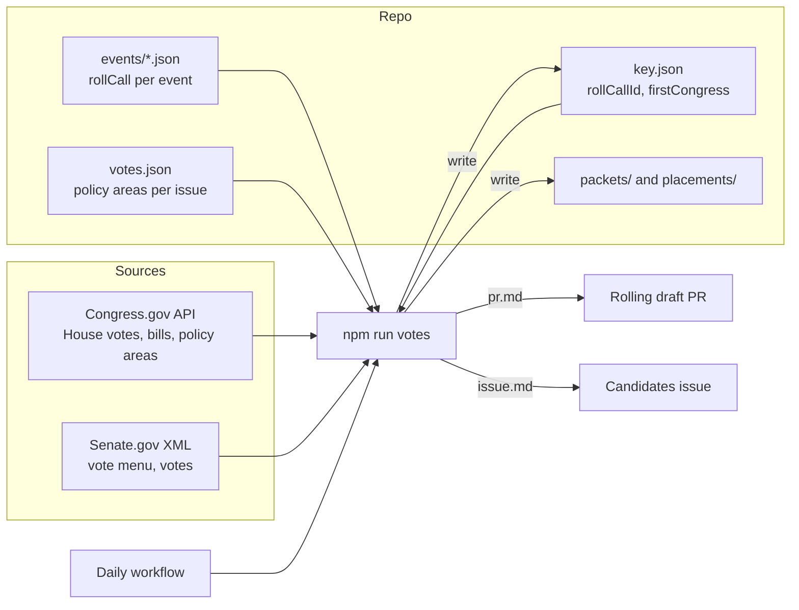

# Vote listener: stances, candidate events, and provisional status from roll calls

**Status:** Approved
**Owner:** Jared Borgese
**Last updated:** 2026-11-26
**Related:** [Phase 6 placement spec](2026-11-phase-6-placement.md) (§4.3.6 Members-elect); PRs #22, #23, #24

---

## 1. Overview / business context

### 1.1 Problem statement

1. Every vote stance in a packet is copied by hand from a roll call. Each new event means looking up every member's vote, and a mistyped stance goes unnoticed because nothing compares packets with the roll call.
2. Nothing tells anyone when Congress votes on a bill that could become an event, so events depend on someone happening to notice the vote.
3. A member-elect stays provisional until their first session ends. Nothing marks that day, so the flag has to be removed by hand, and a forgotten flag keeps waiving rules for someone who by then has a voting record.
4. A member-elect has no roll call ID until sworn in, so their votes cannot be matched to them.
5. Senators will need all of the above once the Senate is added.

**Spec category:** Feature. It adds a new capability: reading roll calls and turning them into evidence and notices. It also adds a scheduled CI workflow, which is why this spec exists.

### 1.2 Business / customer outcome

Jared, as the maintainer, hears within a day about roll calls worth wording as events, gets member stances filled from the official record instead of by hand, and sees provisional status end on time. Success is measured by:

- every plain stance already entered by hand ("Voted for", "Voted against") matching the roll call,
- no stance typed by hand for an event that has a roll call,
- provisional flags removed in the week the second session starts.

### 1.3 Dependencies & assumptions

- **Depends on:**
  - the Congress.gov API's House roll call endpoints (added in 2025, still labeled beta, free key, 5,000 requests an hour);
  - Senate.gov's roll call XML (no key);
  - CRS policy-area terms on Congress.gov bills;
  - GitHub Actions on a public repository.
- **Assumes:**
  - GitHub's runners can reach api.congress.gov and www.senate.gov;
  - CRS assigns a policy area soon after a bill is introduced;
  - Jared adds the Congress.gov key as a repository secret and allows Actions to open pull requests.
- **Risks if wrong:**
  - If a source blocks GitHub's runners, the workflow fails visibly and Jared runs the same command in his own terminal.
  - If policy areas lag, candidates land in the "other passage votes" section instead of under their issue (§4.3.4).

### 1.4 Tenets / constraints

- **The rater never sees anything new.** The only text the listener adds to a record is a fixed stance phrase. IDs, names, and policy areas stay in `key.json` and `votes.json`, which never reach the rater.
- **No spending.** The listener never rates or places. Re-rating stays a paid run that Jared starts.
- **Human judgment stands.** The listener never overwrites a stance, wording, or item someone wrote. Where it disagrees, it reports.
- **Nothing goes live without review.** Every change arrives as a draft pull request. The site build already refuses stale comparisons, so a premature merge fails closed.

---

## 2. Goals

**Goal 1: stances from the record**
As the maintainer, I want member stances on vote events filled from the roll call so that no vote is copied by hand.
**Success signal:** on the 119th Congress roll calls already cited by events, the listener's stances match every plain stance entered by hand.

**Goal 2: notice of votes worth considering**
As the maintainer, I want a running list of recent passage votes, sorted by issue, so that events don't depend on someone noticing.
**Success signal:** a passage vote appears in the list on the first run after Congress.gov or Senate.gov posts it. Congress.gov posted House roll 11 of 2026 about a day after the vote.

**Goal 3: provisional status ends on time**
As the maintainer, I want provisional flags removed when a member's first session ends so that the waiver stops on schedule.
**Success signal:** the removal is proposed on the first run after the 120th Congress's second session opens.

**Goal 4: both chambers**
As the maintainer, I want senators handled the same way as representatives once they're added, with no new rules.
**Success signal:** a Senate event with a roll call fills senators' stances in the same run as the House.

---

## 3. Out of scope

- **Wording events.** Deciding that a vote is an event, and writing its shared text with shares and no names, stays human work. The listener only lists candidates.
- **Caucus and party stances.** These are tallies ("Eight of its ten members voted for…") that depend on membership the repo doesn't hold.
- **"Keeps in place" items and every other item with written text.**
- **Re-rating, placing, and publishing.**
- **Moving a former member-elect from `placements/` to `packets/`.** That's a scale decision for Jared once the flag is gone.
- **Adding senators, Senate events, or the `us-senate` legislature.** This spec only makes the listener ready for them.
- **Cosponsorships, state legislatures, and votes older than the events already cited.**

---

## 4. Proposed solution

### 4.1 Summary

A new `votes` command reads roll calls for every event that names one, fills or checks member stances, resolves missing member IDs, ends provisional status when the second session of a member's first Congress opens, and lists recent passage votes by issue.

- House data comes from the Congress.gov API, whose House votes are copied from the Clerk's files.
- Senate data comes from Senate.gov's XML.
- A daily GitHub Actions workflow runs the command and puts file changes in one rolling draft pull request. The candidate list goes in one issue, because issues don't publish previews.

This beats a local-only command because it needs no one to remember to run it. It beats posting comments on every run because it keeps one PR and one issue current.

### 4.2 Diagram



### 4.3 Component designs

#### 4.3.1 Data fields

**Responsibility:** record which roll call an event is, which member is which in roll call files, and which policy areas belong to which issue.

**Interfaces:** read by `src/files.ts`; written only by the `votes` command (`rollCallId`, removal of `provisional`).

**Access and data:** public data only. The API key is never stored in the repo.

```jsonc
// events/<issue>.json, on an event under us-house or us-senate
"rollCall": { "congress": 119, "session": 1, "number": 190 }

// key.json, on a member subject
"rollCallId": "J000298",   // Bioguide ID in the House, LIS member ID (e.g. "S428") in the Senate
"firstCongress": 120       // on a provisional subject: the Congress they were elected to

// votes.json (new, root)
{ "policyAreas": { "welfare-health": ["Health", "Social Welfare", "Economics and Public Finance"], ... } }
```

**Callouts:**

- `rollCall` must be the vote where Yea or Aye means for the event's text, such as passage or agreeing to a conference report. A motion to recommit or table doesn't qualify.
- Congress.gov identifies House votes by Congress, session, and roll call number, and so does Senate.gov. That's why one shape covers both chambers.
- The Senate's vote files carry LIS IDs, not Bioguide IDs, and Senate.gov has no crosswalk. So `rollCallId` holds whatever ID the member's own chamber uses.

**Open questions:** none.

#### 4.3.2 Sources (`src/voteSources.ts`)

**Responsibility:** the only code that fetches roll calls, member lists, and bills.

**Interfaces:**

- Congress.gov `/house-vote/{congress}/{session}`, `…/{number}`, `…/{number}/members`, and `/bill/{congress}/{type}/{number}`;
- Senate.gov `vote_menu_{congress}_{session}.xml` and `vote_{congress}_{session}_{nnnnn}.xml`.

**Access and data:** reads `CONGRESS_API_KEY` from the environment and sends it as the `X-Api-Key` header, so the key never appears in a URL or an error message.

**Callouts:**

- Results are returned as plain records, and everything after this point is pure.
- The Senate's XML is machine-written with a fixed shape, so a few anchored patterns read it. That avoids adding a parser dependency.
- Pages of 250 are followed until `pagination.next` is empty.

#### 4.3.3 Stance planner (`src/votes.ts`)

**Responsibility:** decide what each member record should say about each event that has a roll call.

**Interfaces:** pure functions over the loaded sets and fetched votes.

**Access and data:** none.

Rules for a member record (packet, or placement without a label) whose subject has a `rollCallId`:

| Roll call shows | Record has | Listener does |
|---|---|---|
| Yea / Aye | nothing, or the event under `noPosition` | adds `{ event, stance: "Voted for" }`, drops it from `noPosition` and `emptySlots` |
| Nay / No | same | adds "Voted against", same clean-up |
| Present, Not Voting, or the member isn't in the roll call | nothing | adds the event to `noPosition` |
| anything | a stance already | leaves it; reports it if a plain "Voted for"/"Voted against" contradicts the vote |

**Callouts:**

- A record already at the 12-item limit isn't changed; the PR body names it. `check` then reports the gap until someone chooses what to drop.
- Calibration copies (`<id>.<label>.json`) are frozen tests and are never edited.
- Stances change the record's evidence text, so its saved comparisons go stale. The PR body gives the comparisons to re-rate for each issue.

#### 4.3.4 Candidates, IDs, and provisional status (`src/votes.ts`)

**Responsibility:** the three notices that don't come from an event.

**Callouts:**

- **Candidates:**
  - These are passage-type votes from the last 14 days, on bills or joint resolutions, that no event already names. Passage-type means passage, suspend-and-pass, concurring in the other chamber's amendment, conference report, or veto override.
  - A vote is listed under every issue whose policy areas include its bill's. Everything else goes in a collapsed "Other passage votes" section.
  - The window keeps the list stateless. A vote stays listed for two weeks.
  - That second section is needed. Tested on the 15 House events already worded, policy areas alone missed two:
    - the premium subsidy extension passed as a vehicle bill filed under "Congress";
    - the protected-status bill is filed under "International Affairs".
- **IDs:** when a member has no `rollCallId`, the latest roll call of their chamber is searched for a unique exact match on first and last name, ignoring accents and case. A match is written and shown in the PR body for review. No match or two matches is reported instead.
- **Provisional status:** when the member's chamber has held any roll call in session 2 of their `firstCongress`, the `provisional` flag is removed. A provisional subject without `firstCongress` is reported.

#### 4.3.5 Command (`src/listener.ts`, `src/cli.ts`)

**Responsibility:** `npm run votes -- preview` prints what would change. `npm run votes -- write [dir]` changes the files and writes `pr.md` and `issue.md` into `dir` (or prints them).

**Callouts:**

- The command covers every issue at once, like `site`.
- With no `CONGRESS_API_KEY`, it stops before any request and names the variable.

#### 4.3.6 Workflow (`.github/workflows/votes.yml`)

**Responsibility:** run the command daily and on demand, and keep one draft PR and one issue current.

**Interfaces:** schedule plus `workflow_dispatch`; the `CONGRESS_API_KEY` secret; `gh` for the PR and the issue.

**Access and data:** the token gets `contents: write`, `pull-requests: write`, and `issues: write`, and nothing else. Actions are pinned to full commit SHAs, and fetched text reaches GitHub only through `--body-file`, never through a shell command line.

**Callouts:**

- **Never force-push.** If a bot PR is open, the run checks out its branch and adds a commit on top, so re-rating commits Jared adds there survive. Otherwise it starts `chore/votes-<date>` from `main`.
- **Pushes only on file changes.** A pushed branch publishes a preview, and that preview fails while comparisons are stale, which is expected.
- **No security scan on the PR.** PRs opened with the workflow's token don't trigger other workflows, so `security.yml` skips them. Its weekly run and its run on each push to `main` still cover them.

---

## 5. Implementation plan

### Ticket 1: the `votes` command

**User Story:** As the maintainer, I need a command that fills stances, resolves IDs, ends provisional status, and lists candidates, so that roll calls reach the records without hand copying.

**Acceptance Criteria:**

- **Data**
  - [ ] `rollCall` on events, `rollCallId` and `firstCongress` on key subjects, and `votes.json` are validated by `src/files.ts`.
  - [ ] All 15 House events name their roll call in `rollCall`. The 10 sitting members carry Bioguide IDs checked against the Clerk's files.
- **Planner**
  - [ ] It applies the stance rules in §4.3.3, including the item limit and `emptySlots` clean-up.
  - [ ] It applies the candidate, ID, and provisional rules in §4.3.4, for both chambers.
- **Command**
  - [ ] `preview` writes nothing. `write` writes records, `key.json`, `pr.md`, and `issue.md`.
  - [ ] It refuses to run without `CONGRESS_API_KEY`.

**Callouts:**

- **Shared types** (`src/files.ts`): new optional fields; the record writer keeps the repo's two-space JSON.
- **Backend logic** (`src/votes.ts`, `src/voteSources.ts`, `src/listener.ts`): pure planner, one fetch module, and the run that joins them.

**Rollout:**
**Test plan:** Vitest with fixtures cut from real House and Senate files, covering every row of the stance table, the item limit, ID matching, session detection, and candidate sorting. A backtest feeds the Clerk's votes for the 15 events through the command: it should report zero disagreements and zero new stances on main. Jared also runs a `preview` locally against the live API.
**Legacy / migration handling:** existing events gain `rollCall` and existing subjects gain IDs. No existing stance changes, and no fingerprint changes.

**Definition of done:** tests, typecheck, and `check` pass for every issue. Reports and the site are unchanged.
**Rollback / feature flag:** revert the PR. Nothing else reads the new fields.

### Ticket 2: the daily workflow

**User Story:** As the maintainer, I need the command to run on its own so that nobody has to remember it.

**Acceptance Criteria:**

- [ ] It runs daily and on demand.
- [ ] One draft PR and one issue are kept current.
- [ ] It never force-pushes, and it pushes only on changes.

**Callouts:**

- **External / prerequisites (do this first):** Jared adds the `CONGRESS_API_KEY` secret and turns on "Allow GitHub Actions to create and approve pull requests".
- **Infrastructure** (`.github/workflows/votes.yml`).

**Rollout:**
**Test plan:** a manual run after merge. Expected result: no PR, because main is up to date, and an issue listing recent passage votes.
**Legacy / migration handling:** none.

**Definition of done:** a manual run succeeds and the issue appears.
**Rollback / feature flag:** disable the workflow in the Actions tab, or delete the file.

---

## 6. Rollout plan

### 6.1 Release strategy

1. Merge Ticket 1 and run `preview` locally.
2. Merge Ticket 2, add the secret, and run the workflow by hand.
3. The first real data arrives when the 120th Congress convenes on 3 January 2027. Members-elect IDs resolve from its first roll calls.

### 6.2 Operational readiness

A failed run shows in the Actions tab, and GitHub emails the repo owner about failed scheduled runs. The PR body lists the re-rating needed for each issue.

### 6.3 Rollback triggers

Disable the workflow if:

- it opens a second PR while one is open,
- a stance ever disagrees with the Clerk's or the Senate's own page for that vote,
- runs fail for three days in a row.

---

## 7. Appendix

### A. Alternatives considered

| Option | Pros | Cons | Why not chosen |
|---|---|---|---|
| Clerk XML directly for the House | Primary source, no key | No list of new votes; needs an XML reader | Congress.gov lists votes and copies the Clerk's data (`sourceDataURL`) |
| ProPublica Congress API | Was a single API for both chambers | "No longer available"; no new keys | Gone |
| GovTrack API | Long history | Ended in 2017 | Gone |
| Local command only | No CI change | Someone has to remember | Jared asked for as much automation as possible |
| Weekly run | Fewer pushes | Slower notice | Pushes already happen only on changes |
| Watch list of bills | No key, quiet | Misses bills nobody listed | Policy areas plus the other-votes section catch more |
| Comment per run | Simple | Noisy history | One issue body kept current |

### B. Policy-area test on existing House events

| Event (issue) | Bill | Policy area | Listed under its issue? |
|---|---|---|---|
| budget-law-health, budget-law-food (welfare) | H.R. 1 | Economics and Public Finance | Yes, that area is in every issue |
| subsidy-extension (welfare) | H.R. 1834 | Congress | **No**: vehicle bill |
| employer-plan-bill (welfare) | H.R. 6703 | Health | Yes |
| budget-law-tax (economics) | H.R. 1 | Economics and Public Finance | Yes |
| overdraft-rule-repeal (economics) | S.J.Res. 18 | Finance and Financial Sector | Yes |
| federal-bargaining-bill (economics) | H.R. 2550 | Labor and Employment | Yes |
| budget-law-energy (environment) | H.R. 1 | Economics and Public Finance | Yes |
| methane-fee-repeal, vehicle-waiver-revocation (environment) | H.J.Res. 35, 88 | Environmental Protection | Yes |
| review-limits-bill (environment) | H.R. 4776 | Environmental Protection | Yes |
| budget-law-enforcement (immigration) | H.R. 1 | Economics and Public Finance | Yes |
| detention-mandate-law, enforcement-funding-law (immigration) | S. 5, S. 2 | Immigration | Yes |
| protected-status-bill (immigration) | H.R. 1689 | International Affairs | **No** |

Policy areas are from GovInfo's BILLSTATUS files, read 26 November 2026.

### C. Operational runbook notes

- **Adding an event with a roll call:** write the event, including `rollCall`, add caucus and party stances, then run `npm run votes -- write` and `npm run check -- <issue>`.
- **After a listener PR:** check out its branch, run `rate` or `place` for each issue its body lists, commit the runs to the branch, mark it ready, and merge.

### D. References

- [Congress.gov API: House roll call vote endpoints](https://github.com/LibraryOfCongress/api.congress.gov/blob/main/Documentation/HouseRollCallVoteEndpoint.md) and its ChangeLog
- [Library of Congress blog, August 2025: House roll call votes on Congress.gov](https://blogs.loc.gov/law/2025/08/congress-gov-enhanced-access-to-house-roll-call-votes-is-now-available/)
- [Senate roll call vote menu, 119th Congress, 2nd session](https://www.senate.gov/legislative/LIS/roll_call_lists/vote_menu_119_2.xml)
- [Clerk roll call 11, 2026](https://clerk.house.gov/evs/2026/roll011.xml)
- [ProPublica Congress API notice](https://projects.propublica.org/api-docs/congress-api/)
